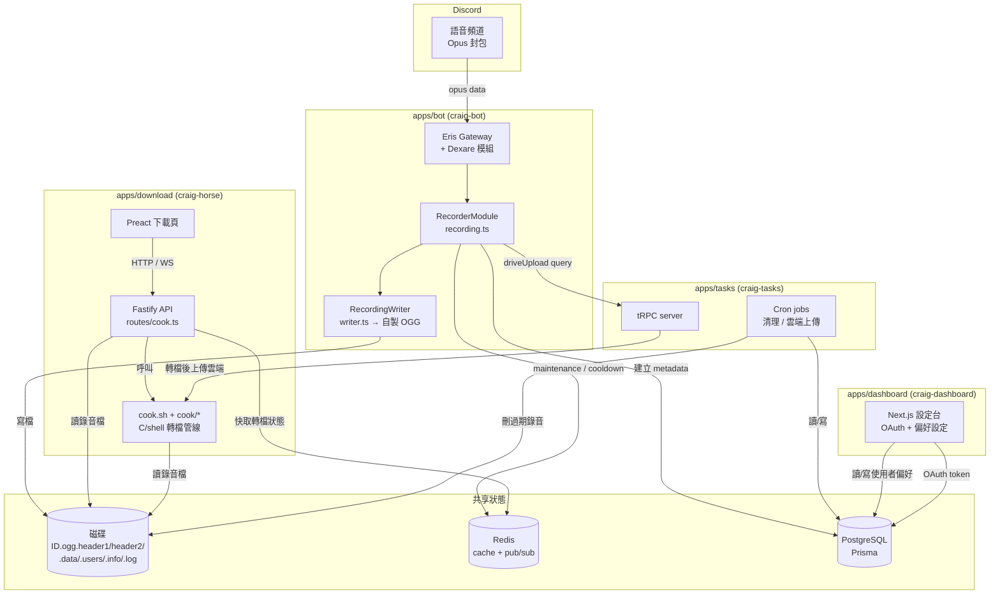
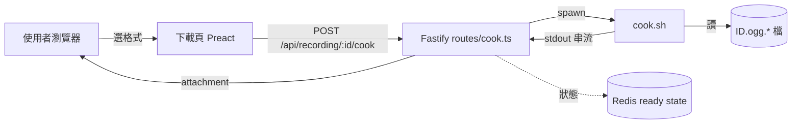
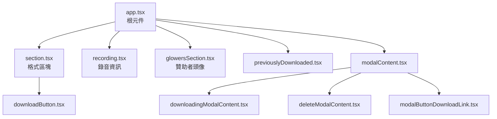
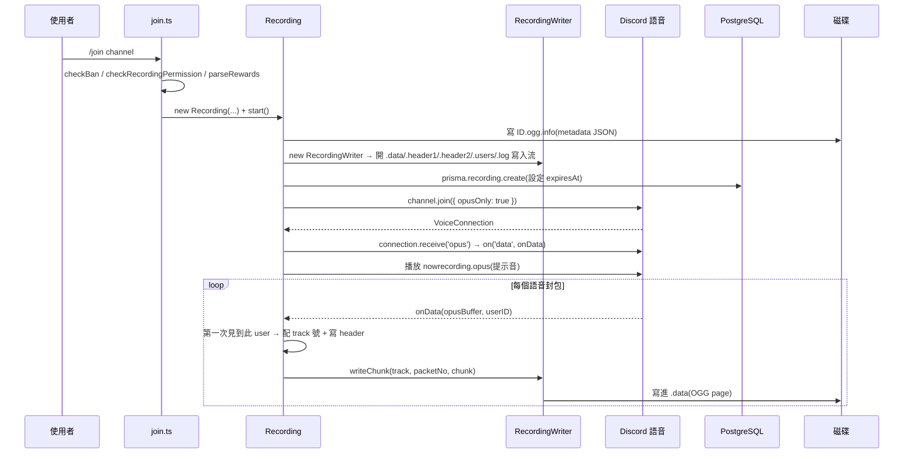
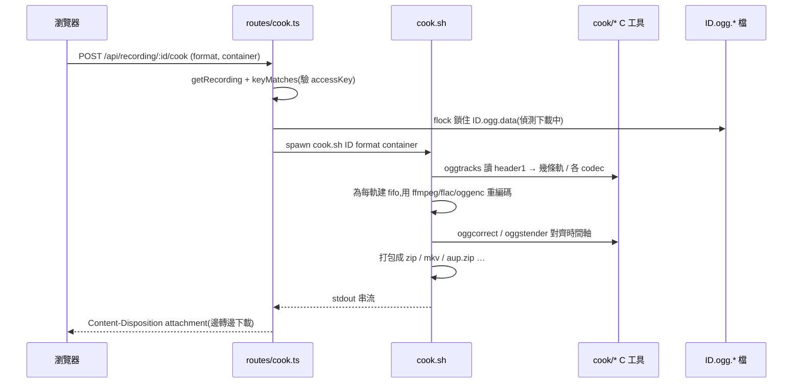
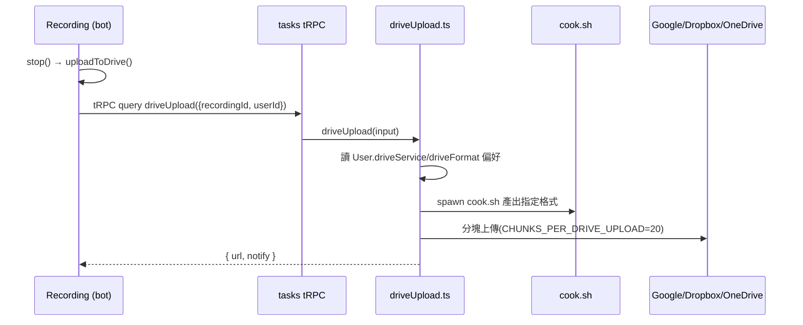

# Craig 程式碼導覽（CODEBASE_GUIDE）

> 給新進工程師的一份「一個下午搞懂 Craig」說明書。Craig 是 Discord 的多軌語音錄音機器人。
>
> 本文件由實際追蹤原始碼產生，所有檔案連結皆可點擊跳轉。

---

## 1. 一句話介紹

**Craig 是一個 Discord 機器人,把語音頻道裡每個人錄成「獨立音軌」,錄完後在網頁上讓使用者選擇格式(FLAC / MP3 / Audacity 專案…)下載或自動上傳到雲端硬碟。**

---

## 2. 30 秒搞懂

- **目的**:在 Discord 語音頻道進行**分軌錄音**(每個說話的人一條音軌),方便 Podcast、會議事後剪輯。
- **主要使用者**:Discord 伺服器管理者 / Podcast 主持人 / 開會的人。
- **輸入**:Discord 語音封包(Opus 編碼),透過 `/join` slash command 觸發。
- **輸出**:一組可下載的多軌音檔(FLAC、MP3、AAC、WAV、Audacity `.aup` 專案等多種格式 + 容器)。
- **核心技術**:TypeScript monorepo(yarn workspaces)+ 一批 C / shell 音訊後製工具(`cook/`)。
- **資料儲存**:PostgreSQL(Prisma ORM)存 metadata、Redis 跨 app 通訊、錄音檔以**自製 OGG 格式**寫在磁碟。
- **部署形式**:四個獨立服務(bot / download / tasks / dashboard),用 PM2 或 Docker 跑,前面靠 Redis + 共享磁碟 + tRPC 串起來。
- **規模**:約 112 個 `.ts` + 39 個 `.tsx` + 34 個 C/header 檔;支援 Discord sharding,設計上是大型公開服務(原版 Craig 服務數十萬伺服器)。

---

## 3. 技術棧


| 層面         | 技術                                                            | 用在哪                                                                              |
| ---------- | ------------------------------------------------------------- | -------------------------------------------------------------------------------- |
| 語言         | TypeScript / Node.js                                          | 四個 app 全部                                                                        |
| 音訊後製       | C(自製 OGG 工具)+ shell + `ffmpeg`/`flac`/`opus-tools`            | `[cook/](cook/)`、`[cook.sh](cook.sh)`                                            |
| Discord 連線 | `eris`(底層 gateway)+ `dexare`(模組框架)+ `slash-create`(slash 指令)  | `[apps/bot](apps/bot)`                                                           |
| 語音編解碼      | `@discordjs/opus`、`sodium-native`、`@snazzah/davey`(DAVE E2EE) | `[apps/bot/src/modules/recorder](apps/bot/src/modules/recorder)`                 |
| Web API    | `fastify`(+ helmet / rate-limit / websocket / static)         | `[apps/download](apps/download)`                                                 |
| 前端(下載頁)    | Preact + TSX,Rollup 打包                                        | `[apps/download/page](apps/download/page)`                                       |
| 前端(設定台)    | Next.js + React(Preact compat)+ Tailwind                      | `[apps/dashboard](apps/dashboard)`                                               |
| 排程任務       | `cron` + `@trpc/server`(被 bot 呼叫)                             | `[apps/tasks](apps/tasks)`                                                       |
| 資料庫        | PostgreSQL + Prisma                                           | `[prisma/schema.prisma](prisma/schema.prisma)`                                   |
| 跨服務通訊      | Redis(pub/sub + cache)、tRPC(bot → tasks)                      | 全部                                                                               |
| 雲端備份       | Google Drive / OneDrive / Dropbox SDK                         | `[apps/tasks/src/queries/driveUpload.ts](apps/tasks/src/queries/driveUpload.ts)` |
| 觀測         | Sentry、InfluxDB(metrics)、`prom-client`                        | 各 app                                                                            |


---

## 4. 架構分層圖

Craig 不是單一服務,而是**四個獨立進程**圍繞著「一份共享的錄音檔 + Redis + PostgreSQL」協作。最值得注意的是:**錄音(bot)和轉檔下載(download)是完全分離的**,中間只靠**磁碟上的檔案**與 Redis 溝通。



> **關鍵心智模型**:`bot` 只負責「把語音封包盡快寫進磁碟」,絕不做 CPU 密集的轉檔;所有「FLAC / MP3 / zip / Audacity」的繁重工作都延後到使用者按下載時,由 `download` app 呼叫 `cook.sh` 即時(on-demand)產生。這是為了讓單一 bot 進程能同時錄很多場。

---

## 5. 目錄結構

```text
craig/
├── apps/                      # yarn workspaces monorepo,四個獨立服務
│   ├── bot/                   # 【核心】Discord 機器人 + 錄音引擎
│   │   └── src/
│   │       ├── index.ts       # 進入點:dotenv + connect()
│   │       ├── bot.ts         # CraigBot(繼承 Dexare),載入所有模組
│   │       ├── commands/      # slash 指令(/join /stop /note /autorecord …)
│   │       ├── textCommands/  # 文字指令(管理用:ban/restart/maintenance …)
│   │       ├── modules/       # Dexare 模組(功能單元)
│   │       │   └── recorder/  # ★ 錄音核心(見第 9 節)
│   │       └── sharding/      # 多進程 sharding 管理(大規模部署用)
│   │
│   ├── download/              # 「craig-horse」轉檔下載服務
│   │   ├── api/src/           # Fastify 後端(routes/ + util/cook.ts)
│   │   └── page/src/          # Preact 下載頁(使用者選格式的 UI)
│   │
│   ├── tasks/                 # 「craig-tasks」排程 + tRPC 服務
│   │   └── src/
│   │       ├── jobs/          # cron:cleanRecordings / cleanDownloads / refreshPatrons
│   │       ├── queries/       # driveUpload.ts(雲端上傳)
│   │       └── trpc.ts        # 暴露給 bot 呼叫的 tRPC API
│   │
│   └── dashboard/             # Next.js 設定台(雲端硬碟連接、偏好)
│       ├── pages/             # 頁面 + pages/api/*(OAuth callback)
│       └── components/        # React/Preact UI 元件
│
├── cook/                      # ★ 音訊後製工具(C + shell + JS)
│   ├── oggduration.c          # 算錄音長度
│   ├── oggtracks.c            # 列出有幾條音軌 / 各自 codec
│   ├── oggcorrect.c           # 修正時間軸(補上靜音、對齊)
│   ├── oggstender.c           # 串流式延展(streaming "stretch")
│   ├── oggmultiplexer.c       # 把多軌合成單一 OGG
│   ├── extnotes.c             # 抽出筆記(/note 標記)
│   ├── *.sh / *.js            # duration/info/notes 等包裝腳本
│   └── windows/ macosx/       # 各平台自解壓 sfx 工具
│
├── cook.sh                    # ★ 轉檔總管線(被 download API 呼叫)
├── prisma/schema.prisma       # 資料庫 schema(見第 9 節)
├── scripts/                   # 維運腳本(buildCook / entitlements / delayExpiry)
├── install.sh / SELFHOST.md   # 自架說明
├── docker-compose.yml         # 容器化部署
└── json-convert.js, stats.js  # 雜項工具
```

---

## 6. API 端點地圖

Craig 有**三組**對外介面,性質完全不同:

### (A) Discord Slash Commands(bot,使用者主要入口)


| 指令                              | 處理檔                                                                     | 用途                   |
| ------------------------------- | ----------------------------------------------------------------------- | -------------------- |
| `/join [channel]`               | `[commands/join.ts](apps/bot/src/commands/join.ts)`                     | **開始錄音**             |
| `/stop`                         | `[commands/stop.ts](apps/bot/src/commands/stop.ts)`                     | 停止錄音                 |
| `/note <message>`               | `[commands/note.ts](apps/bot/src/commands/note.ts)`                     | 在時間軸打標記(剪輯用)         |
| `/recordings`                   | `[commands/recordings.ts](apps/bot/src/commands/recordings.ts)`         | 查目前錄音                |
| `/autorecord on/off/view/prune` | `[commands/autorecord.ts](apps/bot/src/commands/autorecord.ts)`         | 設定「有人進頻道就自動錄」        |
| `/webapp on/off`                | `[commands/webapp.ts](apps/bot/src/commands/webapp.ts)`                 | 開啟即時監看網頁             |
| `/voice-test`                   | `[commands/voice-test.ts](apps/bot/src/commands/voice-test.ts)`         | 測試語音連線               |
| `/server-settings …`            | `[commands/serversettings.ts](apps/bot/src/commands/serversettings.ts)` | 伺服器層級設定(存取角色、bot 頭像) |
| `/bless` `/unbless`             | `[commands/bless.ts](apps/bot/src/commands/bless.ts)`                   | 把贊助者權益「祝福」給整個伺服器     |
| `/features` `/info`             | `[commands/features.ts](apps/bot/src/commands/features.ts)`             | 查權益 / bot 資訊         |


### (B) 下載 HTTP API(download / Fastify,預設 port 5029)

註冊位置:`[apps/download/api/src/api.ts](apps/download/api/src/api.ts)`。處理邏輯在 `[routes/cook.ts](apps/download/api/src/routes/cook.ts)` 與 `[routes/recording.ts](apps/download/api/src/routes/recording.ts)`。


| Method   | Path                          | 用途                                   |
| -------- | ----------------------------- | ------------------------------------ |
| GET      | `/api/recording/:id`          | 取錄音 metadata(`headRoute`/`getRoute`) |
| DELETE   | `/api/recording/:id`          | 刪除錄音(需 deleteKey)                    |
| GET      | `/api/recording/:id/users`    | 列出音軌使用者                              |
| GET      | `/api/recording/:id/duration` | 算長度(呼叫 `cook/duration.sh`)           |
| GET      | `/api/recording/:id/notes`    | 取筆記(呼叫 `cook/jsonnotes.sh`)          |
| GET      | `/api/recording/:id/raw`      | 取原始多軌                                |
| GET/POST | `/api/recording/:id/cook`     | **核心:跑 `cook.sh` 轉檔並串流下載**           |
| GET      | `/api/ennuizel` (WebSocket)   | 串原始音軌給 Ennuizel 線上編輯器                |
| GET      | `/dl/:file`                   | 下載已產生的檔                              |
| GET      | `/health`                     | 健康檢查                                 |




### (C) Dashboard API Routes(dashboard / Next.js)

放在 `[apps/dashboard/pages/api/](apps/dashboard/pages/api)`,主要是 **OAuth callback** 與偏好設定:`login`/`logout`、`google|microsoft|dropbox/oauth`、`patreon/webhook`、`user/drive`。

---

## 7. Component 樹(下載頁)

下載頁是 Preact 寫的單頁應用,進入點 `[apps/download/page/src/components/app.tsx](apps/download/page/src/components/app.tsx)`。



> Dashboard(Next.js)的元件樹較淺,主要是 `[pages/index.tsx](apps/dashboard/pages/index.tsx)` 組合一堆按鈕元件(`GoogleButton`/`DropboxButton`/`MicrosoftButton`/`Toggle`/`Dropdown`),用來連接雲端硬碟與選擇預設輸出格式。

---

## 8. 關鍵流程序列圖

### 流程 A:開始一場錄音(`/join`)



幾個**不直覺但重要**的點:

1. **每個說話者 = 一條 track**。track 號在 `[getOrCreateRecordingUser](apps/bot/src/modules/recorder/recording.ts)` 裡用 `this.trackNo++` 遞增配發,header 也是此時才寫。這是「分軌錄音」的核心。
2. **RTP header 要剝掉**:`encodeChunk` 會偵測 `0xbe 0xde` 開頭的 RTP extension 並切掉,才存純 Opus([recording.ts](apps/bot/src/modules/recorder/recording.ts) `encodeChunk`)。
3. **Cloudflare 語音伺服器的怪封包**:`onData` 會丟掉「幾乎全是 0」的封包(`c-` 前綴伺服器會無故送)。
4. **寫檔是序列化的**:`RecordingWriter` 用 `fastq` concurrency=1 的 queue,確保 OGG page 順序正確。
5. **尺寸硬上限**:`increaseBytesWritten` 累計位元組,超過 `sizeLimit` 就自動停錄。

### 流程 B:下載 / 轉檔(`cook.sh`)



**為何這樣設計**:`cook.sh` 完全是 stream pipeline——用具名管道(`mkfifo`)把每條音軌的解碼、重編碼、打包串起來,**不落地暫存完整檔案**,邊轉邊吐給使用者。`flock` 鎖是用來判斷「這個錄音正在被下載」,避免清理 job 把它刪掉。`cook.sh` 還設了 `ulimit` 與 `oom_adj`,因為它是會吃 CPU/記憶體的不可信轉檔工作。

### 流程 C:錄完自動上傳雲端硬碟



> bot 與 tasks 是**不同進程**,靠 tRPC over HTTP(預設 port 2022,見 `[tasks/trpc.ts](apps/tasks/src/trpc.ts)`)通訊。bot 端 client 建在 `[recorder/index.ts](apps/bot/src/modules/recorder/index.ts)`。

---

## 9. 重要模組逐個說明

### `apps/bot/src/modules/recorder/`(錄音核心)

- **做什麼**:整個專案的心臟。接 Discord 語音、配軌、編碼、寫檔。
- **關鍵檔案**:
  - `[recording.ts](apps/bot/src/modules/recorder/recording.ts)`(~1000 行)——單場錄音的狀態機(`RecordingState`: IDLE→CONNECTING→RECORDING→ENDED),負責連線、重連、封包處理、警告(被踢/靜音/延遲過高)。
  - `[writer.ts](apps/bot/src/modules/recorder/writer.ts)`——把 chunk 寫成五個檔:`.data`(音訊)、`.header1`/`.header2`(OGG header)、`.users`(誰是哪軌的 JSON)、`.log`。
  - `[ogg.ts](apps/bot/src/modules/recorder/ogg.ts)`——**手寫 OGG 封裝**(自己組 `OggS` page header、算 CRC32)。
  - `[webapp.ts](apps/bot/src/modules/recorder/webapp.ts)` + `[protocol.ts](apps/bot/src/modules/recorder/protocol.ts)`——即時監看網頁的 WebSocket 協定(Ennuicastr)。
- **陷阱**:錄音檔不是標準可播放的 OGG,而是 Craig **自訂的多軌容器**(`.header1`/`.header2`/`.data` 分離)。必須經過 `cook.sh` + `cook/` C 工具才能還原成正常檔案。想看懂格式要同時讀 `ogg.ts`(寫)和 `cook/oggtracks.c`(讀)。

### `cook/` + `cook.sh`(音訊後製管線)

- **做什麼**:把自訂 OGG 還原、對齊時間軸、重新編碼成使用者要的格式與容器。
- **關鍵檔案**:`[cook.sh](cook.sh)`(總控)、`[cook/oggcorrect.c](cook/oggcorrect.c)`(補靜音對齊時間)、`[cook/oggmultiplexer.c](cook/oggmultiplexer.c)`(合軌)、`[cook/extnotes.c](cook/extnotes.c)`(抽 `/note` 標記轉成 Audacity label)。
- **陷阱**:C 工具要先編譯(`[scripts/buildCook.sh](scripts/buildCook.sh)` / `cook/Makefile`)。`cook.sh` 大量用 `mkfifo` 串流,debug 時不會有中間檔可看。

### `apps/download/api/`(轉檔下載服務)

- **做什麼**:對外的 HTTP/WS API,驗 key、呼叫 `cook.sh`、串流回傳、管理下載狀態。
- **關鍵檔案**:`[util/cook.ts](apps/download/api/src/util/cook.ts)`(包裝 `cook.sh` 與允許的格式/容器清單)、`[util/processManager.ts](apps/download/api/src/util/processManager.ts)`(管子進程)、`[routes/ennuizel.ts](apps/download/api/src/routes/ennuizel.ts)`(串給線上編輯器)。
- **陷阱**:它和 bot **共用同一個錄音資料夾**(磁碟),所以兩個 app 必須能存取同一路徑。`allowedFormats` / `allowedContainers` 是白名單,新增格式要同時改這裡和 `cook.sh`。

### `apps/tasks/`(排程 + tRPC)

- **做什麼**:跑 cron 清理過期錄音/下載、刷新 Patreon 贊助狀態;並提供 `driveUpload` tRPC 給 bot 呼叫。
- **關鍵檔案**:`[jobs/cleanRecordings.ts](apps/tasks/src/jobs/cleanRecordings.ts)`、`[jobs/refreshPatrons.ts](apps/tasks/src/jobs/refreshPatrons.ts)`、`[queries/driveUpload.ts](apps/tasks/src/queries/driveUpload.ts)`。
- **陷阱**:job 是靠 `index.ts` 掃 `jobs/` 資料夾自動載入並各自註冊 CronJob;每個 job 必須 `extends TaskJob` 並設 `time`(cron 字串)。

### `apps/dashboard/`(設定台)

- **做什麼**:Next.js 網站,讓使用者用 Discord OAuth 登入、連接雲端硬碟、設定預設輸出格式;以及接 Patreon webhook 更新權益。
- **關鍵檔案**:`[pages/index.tsx](apps/dashboard/pages/index.tsx)`、`[pages/api/patreon/webhook.ts](apps/dashboard/pages/api/patreon/webhook.ts)`、各 `pages/api/*/oauth.ts`。
- **陷阱**:雖然用 React,實際透過 `preact-compat` 打包成 Preact。token 直接存 PostgreSQL(`GoogleDriveUser`/`MicrosoftUser`/`DropboxUser` 表)。

### 跨服務的「合約」

- **資料庫**:`[prisma/schema.prisma](prisma/schema.prisma)` 是四個 app 共用的單一真相。重點表:`Recording`(metadata + `expiresAt`)、`User`(權益等級 + 雲端偏好)、`AutoRecord`(自動錄音規則)、`Entitlement`/`Patreon`/`Blessing`(贊助權益)。
- **磁碟檔案**:`{recordingId}.ogg.{info,header1,header2,data,users,log}` 是 bot(寫)與 download/tasks(讀)之間的真正介面。
- **Redis**:維護模式旗標、cooldown、轉檔 ready 狀態。

---

## 10. 從這裡開始讀(建議閱讀順序)

1. **想懂「錄音怎麼運作」** → 先讀 `[apps/bot/src/modules/recorder/recording.ts](apps/bot/src/modules/recorder/recording.ts)` 的 `start()` → `connect()` → `onData()` → `encodeChunk()`,再看 `[writer.ts](apps/bot/src/modules/recorder/writer.ts)` 與 `[ogg.ts](apps/bot/src/modules/recorder/ogg.ts)`。
2. **想懂「使用者怎麼觸發」** → 讀 `[commands/join.ts](apps/bot/src/commands/join.ts)` 和 `[commands/stop.ts](apps/bot/src/commands/stop.ts)`,再回頭看 `[bot.ts](apps/bot/src/bot.ts)` 怎麼載入模組。
3. **想懂「錄完怎麼變成下載檔」** → 讀 `[cook.sh](cook.sh)`,搭配 `[apps/download/api/src/routes/cook.ts](apps/download/api/src/routes/cook.ts)` 與 `[util/cook.ts](apps/download/api/src/util/cook.ts)`。
4. **想懂「資料怎麼存」** → 讀 `[prisma/schema.prisma](prisma/schema.prisma)`。
5. **想懂「雲端上傳 / 排程清理」** → 讀 `[apps/tasks/src/index.ts](apps/tasks/src/index.ts)` 與 `[queries/driveUpload.ts](apps/tasks/src/queries/driveUpload.ts)`。
6. **想自己架起來** → 讀 `[SELFHOST.md](SELFHOST.md)` 與 `[install.sh](install.sh)`,搭配 `[docker-compose.yml](docker-compose.yml)`。

---

*本導覽聚焦在「Craig 如何把 Discord 語音變成可下載的多軌音檔」這條主線。各模組更細節的設定(sharding、entitlements、metrics)在對應的 `modules/` 檔案裡,需要時再深入。*